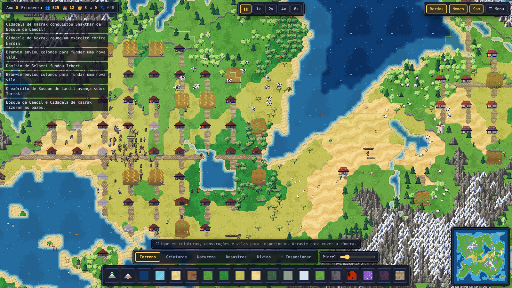
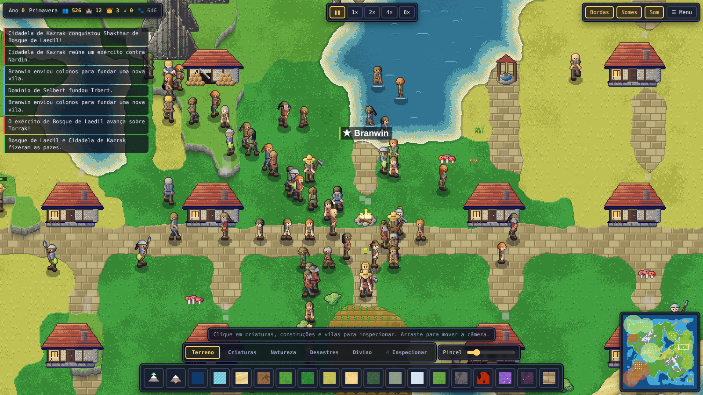
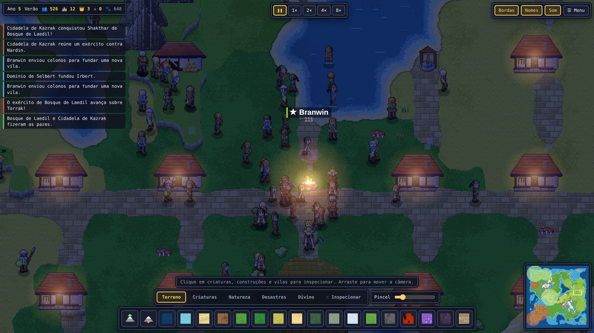
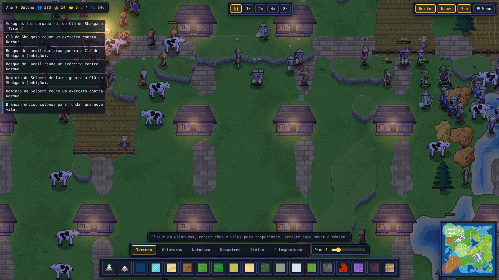

# Aethoria

Sandbox divino 2D em pixel art, no espírito de WorldBox: você pinta o mundo, solta criaturas, e povos
nascem, constroem vilas, fundam reinos e vão à guerra — tudo simulado de verdade, em tempo real.
Reescrita do zero do jogo antigo desta pasta-mãe; os erros daquele jogo estão catalogados em
[`DESIGN.md`](./DESIGN.md) junto com a regra que cada um gerou.



| | |
|---|---|
|  |  |
|  | |

```bash
cd aethoria
npm install
npm run dev        # http://localhost:5200
npm test           # simulação headless: mundo, batalha, cerco, save/load
npm run typecheck  # inclui tests/
```

## Como jogar

| | |
|---|---|
| Arrastar (botão esquerdo, sem ferramenta) / botão direito / `WASD` | mover a câmera |
| Roda do mouse, `+` `-` | zoom em passos inteiros (pixel art nítida) |
| Clique em criatura, prédio ou vila | inspecionar (seguir, curar, matar, demolir, impor paz…) |
| Abas **Terreno · Criaturas · Natureza · Desastres · Divino** (`Q`/`E` trocam) | escolher poder; segure o botão para repetir |
| `[` `]` ou slider | tamanho do pincel |
| `Espaço`, `1`–`4` | pausar, velocidades 1× 2× 4× 8× |
| `Esc` | voltar a inspecionar |

Menu: novo mundo (5 formas, tamanho, água/montanhas/florestas/clima, povos, semente), salvar/carregar
(navegador) e exportar/importar arquivo.

## O que existe

* **Mundo** — biomas por temperatura × umidade × altitude, praias, rios, lagos, colinas, cordilheiras nevadas,
  minérios. Terreno pintado em pixel por chunk: bordas orgânicas, falésias 3/4, areia molhada, plataforma
  rasa com espuma, água animada. Estações mudam as árvores; dia/noite com luz de fogueira e janelas; chuva,
  neve, névoa e tempestade com raios.
* **Arte** — tudo desenhado por código, 1 tile = 32 px: humanos, elfos, anões e orcs com rig esquelético
  (cinemática inversa nas pernas e braços, 4 direções reais, 13 animações: andar, correr, golpear, atirar,
  cortar, minerar, cultivar, martelar, conjurar, morrer…); 11 animais, dragão e zumbi; aríete e catapulta; 13 tipos de
  prédio em 4 estilos de raça, com obra em andamento, dano e fumaça de chaminé.
* **Vida** — fome, idade, nascimento, trabalho físico (lenha, pedra, fazenda, construção, caça), ecologia com
  predadores e presas, fogo que se espalha, lava que esfria, árvores que crescem e semeiam.
* **Civilização** — grupos fundam vilas; o planejador loteia o terreno, pavimenta ruas e constrói; território com
  borda; colonos fundam novas vilas; reis com temperamento; lealdade que pode virar revolta.
* **Guerra** — diplomacia por relação e temperamento, exércitos que se reúnem, marcham em formação e cercam;
  arqueiros com flechas em arco, torres que atiram, aríetes que derrubam portas, catapultas que lançam pedras;
  conquista troca a cor da vila. **Um modelo só:** a batalha é o combate físico, sem planilha escondida.
* **Poderes** — 19 pincéis de terreno, 17 criaturas, natureza, tornado, meteoro, terremoto, vulcão, chuva ácida,
  enchente, bomba, peste (levanta zumbis), bênção, maldição, punição, guerra e paz.

## Arquitetura

```
src/core    rng, ruído, config (TILE=32, 20 Hz), save, som sintetizado
src/world   tipos de terreno/objeto, grade em arrays tipados, gerador
src/gfx     pintor de pixels, terreno assado, rig humanoide, animais, flora, montanhas, prédios, engenhos
src/sim     espécies, unidades, A*, IA civil e fauna, combate, cidades, reinos, cerco, desastres, poderes
src/render  câmera, renderizador único (ordenação por Y global), partículas, atmosfera
src/ui      HUD em DOM, ícones, inspetor, minimapa
tests       assert puro; `npm test` roda tudo
tools       sondas de balanceamento, capturas de tela, folhas de sprites
```

Ferramentas úteis: `npx tsx tools/probe2.ts 1200 7 192` (série temporal de um mundo de 4 povos),
`?mode=roster|anim|flora|animals|buildings|engines` em `/sheet.html` (folha de sprites),
`window.aethoria.debugBattle()` no console.

## Ainda não

Navios e portos, muralhas e portões, alianças entre reinos, música, toque/celular. O jogo antigo (`../src`)
continua no repositório como referência; nada dele foi apagado.
